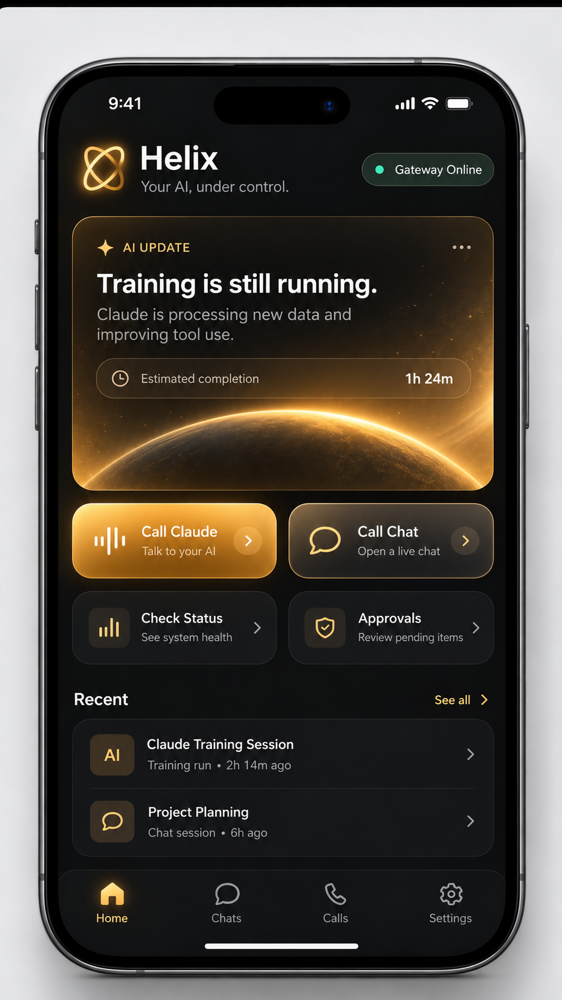

# Helix

Follow and steer your **Claude Code** and **Codex** sessions from your phone while you are away from your PC.

**[▶ Watch the 48-second Helix demo](design/Helix_Launch_Trailer_1080x1920.mp4)**

Helix is a small always-on gateway that runs on your Windows PC, plus an iPhone app (with CarPlay and Siri) and an
Android app that talk to it over your private Tailscale network. Your agents keep running on your own machine with your own
logins. Helix lets you chat with them, get pinged when something finishes or breaks, and approve or reject anything
destructive from your phone.

```
iPhone / CarPlay, Android  --HTTPS + WebSocket (Tailscale)-->  PC gateway (Windows service)  -->  Claude Code / Codex sessions
ChatGPT / claude.ai  --hosted MCP (Tailscale Funnel, OAuth)-->  same gateway   (optional)
```



## What it does

- **Every session on your PC, from your phone.** Helix indexes the Claude Code and Codex sessions already on the
  machine (terminal, IDE, desktop app) and shows which are busy. It can continue any of them, fork one, or start a new one.
- **Chat and voice.** Text chat over WebSocket, plus phone calls through CallKit: "Call Claude" or "Hey Siri, call Astra".
  A front-door router finds the session you mean and hands the conversation to it.
- **Approvals with one rule.** Normal agent actions run automatically. Deletions and other irreversible actions
  (`rm`, `git reset --hard`, force-push, `DROP TABLE`, ...) pause until you approve on the phone. Approvals fail closed.
  Spoken approvals are matched by keywords on the phone and never interpreted by a model.
- **Watchers.** Cheap, deterministic status checks for any job: processes, logs, files, HTTP, GPU, git and agent
  sessions. Agents can set them up themselves with `watch_job`.
- **Push everywhere, calls when you are away.** Important and critical events, and approval requests, push to your
  phone whether or not you are at the PC. Presence only decides whether your phone *rings*: critical events and
  long-waiting approvals call you when you are away, and stay quiet when you are at the PC.
- **Hosted access (optional).** Add Helix as a custom connector in ChatGPT or claude.ai to check on your PC from
  anywhere. A strict safe-command policy applies, and credentials are never readable.
- **Optional extras.** A local PC voice (bring your own TTS model), desktop control for hosted chats (opt-in), and
  a Claude Code mod that shows context size and usage left.

## Features

Every feature, what it does, and how to use it. "Needs" lists what must be set up first; anything not listed works
out of the box after the [quick start](#quick-start).

### 1. See and continue every session on your PC

| | |
|---|---|
| **What** | Helix reads the transcripts Claude Code and Codex already write, so sessions started in a terminal, an IDE or the desktop app all show up with a live busy/idle status. |
| **Use it** | Open **Chats** in the app. Tap a session to read it and reply. Or `npm run sessions` on the PC, `GET /v1/agent-sessions`. |
| **Continue modes** | `resume` (same conversation), `fork` (branch, original untouched), `auto` (fork if a terminal has it open, otherwise resume). Two processes never write one transcript. |
| **Needs** | Nothing. Codex gets visibility and chat; the terminal permission gate is Claude Code only for now. |

### 2. Chat from your phone

Text chat over a live WebSocket with streamed output, tool activity, interrupt, and history sync after a reconnect
(every message has a sequence number). Send a message, tap stop to interrupt the running turn, or start a new session
in any project. REST and WebSocket reference: [pc-gateway/README.md](pc-gateway/README.md).

### 3. Calls, Siri and CarPlay

| | |
|---|---|
| **What** | A real phone call (CallKit) with a voice loop: speech recognition on the phone, barge-in, short spoken replies (two or three sentences, enforced by the gateway). Home has **Call Claude** and **Call Astra**. |
| **Use it** | Tap a call card, or say "Hey Siri, call Claude" / "call Astra". In the car the same buttons appear in CarPlay. |
| **Incoming calls** | Helix can call *you* when something is critical, or an approval has waited too long. |
| **Needs** | A paid Apple Developer account and your own APNs key for incoming calls and Siri ([docs/PUSH-SETUP.md](docs/PUSH-SETUP.md)); the CarPlay entitlement from Apple ([docs/CARPLAY.md](docs/CARPLAY.md)). Protocol: [docs/CALLS.md](docs/CALLS.md). |

### 4. General Claude and Astra: one conversation, right session

You do not have to name a session. "Call Claude" starts at a hidden **router** that has no shell and no file access:
it can only search sessions, read a short summary, list projects, start or resume a session, and hand the
conversation over. After the handoff the *same* conversation talks to that session. A session open in a terminal is
not forked: your message goes into that very session. Say "connect me to the cat training session" to be switched
without sending it a task. **Aliases** (`PUT /v1/aliases/:name`) name your favorite sessions or projects so Siri,
CarPlay and the router can find them ("cat training"). "Astra" is the same front door for Codex.

### 5. Approvals

| | |
|---|---|
| **Rule** | Normal work runs automatically. Deletions and other irreversible actions pause until you approve. Approvals fail closed (reject, expiry, interrupt or restart all mean "no"). |
| **What is caught** | `rm`, `Remove-Item`, `git reset --hard`, force-push, `git clean`, SQL `DROP`/`DELETE`, disk formatting, docker/service removal, tools *named* delete/remove/wipe, and commands it cannot inspect (encoded PowerShell, download piped to a shell). |
| **Use it** | Approve or reject from the app (Face ID / passcode required), a notification, or by voice on a call. Spoken approvals use fixed keywords on the phone, never a model. |
| **Terminal sessions** | While you are away, a `PreToolUse` hook sends destructive commands from *any* terminal session, even one started with `--dangerously-skip-permissions`, through the same flow. It fails open if Helix is down, so it can never block your work. |
| **Limit** | A strong guardrail, not a sandbox. An agent that writes a deleting script and then runs it looks harmless to a pattern matcher. Keep backups. |

### 6. Status watchers (no model, no tokens)

Cheap, deterministic checks on a timer. They fire when a condition *becomes* true and again when it recovers, collapse
repeated lines, and survive gateway restarts.

| Type | Fires when | Example use |
|---|---|---|
| `process` | a pid/name stops (or, with `expect: stopped`, when it finishes) | "tell me when this build exits" |
| `log` | a regex matches a new line, or the log goes quiet | `ERROR`, `CUDA out of memory`, `Epoch 10/10` |
| `file` | exists / missing / modified / stale | a checkpoint appears, a heartbeat file stops updating |
| `command` | a non-destructive PowerShell check stops matching | `docker ps` still shows the container |
| `http` | a URL fails N times in a row | your local dev server or a deployed site |
| `gpu` | too hot, VRAM nearly full, or idle too long | a stalled training run |
| `git` | HEAD moves or the branch changes | an agent committed |
| `session` | an agent task finishes, fails, stalls, or waits on an approval | "ping me when the refactor is done" |

- **Zero setup for agent work:** a default watch tells you when any agent task that ran 2+ minutes finishes, fails or stalls.
- **One call for a job:** `watch_job` turns `{name, profile, pid?, logPath?}` into process + log (+ GPU) watches. Profiles: `generic`, `training`, `build`, `tests`, `deploy`, `download`. Agents call it themselves; your global CLAUDE.md / AGENTS.md can tell them to.
- **Wake an agent:** a watch can hand its event to a session (`wakeMe`) so the agent investigates. This is the only watcher feature that spends tokens, and it is rate limited.
- **Severity:** `info` stays in the app, `important` pushes, `critical` pushes and rings (at most once per problem per 15 minutes, 3 calls an hour).

### 7. Push, calls and presence

Helix knows whether you are at the PC (keyboard/mouse activity, or set `auto` / `away` / `home` yourself).

- `info` stays in the app.
- `important` pushes, whatever the presence mode.
- `critical` pushes whatever the presence mode, and also rings your phone, but only while you are away. Calls also
  follow the cooldown (one ring per problem per 15 minutes) and the 3-calls-per-hour cap.
- An approval request pushes at once, wherever you are. A delayed call for an unanswered approval follows the same
  call rules.

If the desktop helper is not running, Helix assumes you are away. Without an APNs key everything still lands in the
app over the live connection.

### 8. Agent tools (what your agents can call)

`npm run helix -- connect` adds the `helix` MCP server to every new Claude Code and Codex session. Which tools an agent
gets depends on its **scope**:

| Tool | What it does | Scope |
|---|---|---|
| `notify_user` | Message the phone: `info` (in-app), `important` (push), `critical` (rings). Reports which channels delivered. Hosted chats can push but never ring: `critical` is capped at a push, and they get 10 per connector per 10 minutes. | all agents, `pc.control`, hosted |
| `request_user_approval` | Ask you a yes/no question and block until you answer on the phone. | agents |
| `watch_job`, `create_status_watch`, `list_status_watches`, `remove_status_watch` | The watchers above. | agents (`list` for observers too) |
| `list_agent_sessions` | See the sessions Helix manages. | agents, observers |
| `end_call` | Hang up a live call after the goodbye. | agents |
| `get_pc_status`, `get_gpu_status`, `list_processes`, `get_process_status`, `get_service_status` | CPU, RAM, disk, GPU, processes and Windows services. | observers, hosted |
| `list_directory`, `read_file`, `tail_file`, `git_status`, `git_log`, `get_training_status` | Look at files, logs, repos and a training run's latest step/loss. Credentials are never readable. | observers, hosted |
| `run_safe_command` | One short PowerShell command that passes the hosted safety rules. | hosted |
| `run_command`, `write_file`, `stop_process` | Full control with the approval gate applied. | `pc.control` |
| `list_apps`, `open_app`, `close_app` | Launch or politely close Start-menu apps. Shells, editors with agent sessions, Helix and Tailscale are protected. | hosted, control |
| `search_agent_sessions`, `read_agent_session`, `send_agent_message` | **See and talk to other agent sessions** (see "Agents talking to each other" below). | hosted, `pc.control` |
| `send_user_message` | Drop a message into the app (no push). | observers, hosted |
| `get_session_summary`, `list_projects`, `start_agent_session`, `resume_agent_session`, `handoff_current_conversation` | The router's tools. | router only |

Scopes: `pc.observe` (read only), `pc.hosted` (observe + safe commands + apps + agent chat), `pc.control`
(+ commands, files, processes), `pc.agent.local` (terminal agents: watchers and reaching you, no shell or file writes),
`pc.agent.full` (agents Helix spawns), `pc.router`. Phone device tokens are not MCP credentials.

### 9. Hosted access: ChatGPT and claude.ai

Add Helix as a custom connector (`https://<pc>.<tailnet>.ts.net/mcp`, OAuth) and ask from anywhere: "how is training
going?", "is the build still running?", "open Spotify". Hosted chats can look and run small safe commands, but get
**no approval prompts**: anything risky is refused and the chat is told to ask you in the Helix app. Credentials,
`.env` and keys are never readable, every call is audited. Setup: [docs/HOSTED.md](docs/HOSTED.md).

### 10. Desktop control (opt-in)

**Why it exists.**
- **Any chat can do it.** Desktop control normally needs a vendor's desktop app and its built-in computer-use tool. With Helix, a plain chat in the browser or phone app (ChatGPT, or claude.ai) can control your PC through the connector, so you do not have to install or run those apps.
- **It can save your coding limits.** As of October 2026, ordinary ChatGPT chat conversations do not count against the 5-hour and weekly usage limits that coding agents (Codex, Claude Code) draw from. Driving desktop control from a chat leaves those limits for the agents doing your coding, so you can enjoy long desktop sessions without spending them. Provider plans and limits change, so check your own plan before relying on this.

A hosted chat can see and operate your screen: `get_screen_info`, `get_active_window`, `start_desktop_control`,
`take_screenshot`, `click`, `double_click`, `right_click`, `move_mouse`, `type_text`, `press_key`, `scroll`, `drag`,
`stop_desktop_control`. It is off until you enable it per connector (`npm run desktop -- enable <id>`). A gold aura
shows when Helix is in control; touching the real mouse or keyboard, or pressing **Ctrl+Alt+Shift+F12**, takes over
instantly. The control tools are plain MCP tools, so any connector you enable can use them; only the live video card
below is ChatGPT-specific. Details and safety rules: [pc-gateway/docs/COMPUTER-USE.md](pc-gateway/docs/COMPUTER-USE.md).

#### Helix Live: watch your agent work, inside ChatGPT

While desktop control is active, Helix can show a **live, view-only video of the controlled monitor right in the
ChatGPT conversation**, so you see what the agent is clicking and typing instead of trusting a text description.

- **Live card.** `start_desktop_control` renders a compact stream widget in the chat while control is running. It
  follows the monitor holding the active window, and closes itself when control ends.
- **Helix Live panel.** A read-only thread panel (tool `helix_live_panel`) you can open yourself to see the current
  session. It never starts control, never extends the control lease and never captures anything on its own.
- **Spectator only.** The video has no input channel, no audio and no recording, and it never creates model
  screenshots. Closing the card does not interrupt the agent. One viewer per session.
- **Private.** A random capability, bound to that connector and that control session, gates the stream. Stopping
  control, touching the real mouse or keyboard, locking the PC, or revoking the grant ends it immediately.
- **Transport.** Windows helper, FFmpeg capture, WebRTC (direct or STUN, or your own TURN relay from `.env`). If WebRTC
  fails it falls back to an 8 fps JPEG stream over the existing gateway tunnel and reconnects on its own.
- **Turn it on.** Desktop control must be enabled for the connector, Funnel must be set up so the gateway has a public
  URL, and `HELIX_VIEWER_CARDS=true` in `.env` turns on the card. After deploying, refresh the connector's tools in
  ChatGPT (a fresh chat helps).
- **Status.** Experimental: it needs the ChatGPT apps UI, and the card still needs more testing on the phone.

Design, privacy and failure handling: [pc-gateway/docs/LIVE-DESKTOP-VIEWER.md](pc-gateway/docs/LIVE-DESKTOP-VIEWER.md).

### 11. Voice and personality

Replies on calls are spoken with Apple's voice by default. Optionally plug in a local text-to-speech model on your GPU
([docs/LOCAL-TTS.md](docs/LOCAL-TTS.md)): it starts only when a call needs it, checks free VRAM and RAM first, and
stops itself when idle. Personality modes `professional` (default), `casual`, `playful`, `flirty` and `unhinged`, with
sliders for teasing, flirtiness, sarcasm and verbosity ([docs/PERSONA.md](docs/PERSONA.md)). It changes wording only.
Critical alerts and approvals are always plain, and a work session never gets the flirty character.

### 12. Spoken digest

`GET /v1/digest` is an instant summary with no model: approvals waiting, watches
firing, what is working. It comes in your chosen personality, or `?plain=true` for neutral wording.

### 13. Usage guard (Claude Code mod)

A line above the Claude Code prompt: live context size (yellow at 150k tokens, red at 300k) and 5-hour and weekly usage
left with a reset countdown. Works without the gateway. See [mods/usage-guard](mods/usage-guard/README.md).

### 14. Heavy-session guard

Messaging a very large session (about 150k tokens or more) after its prompt cache went cold is expensive. Helix
refuses until you confirm (`HELIX_HEAVY_SESSION_TOKENS`, `HELIX_CACHE_COLD_SEC`).

### 15. Device-key signing

Optionally require every request, and the WebSocket upgrade, to be signed by a key held in your phone's Secure Enclave,
so a leaked token alone is useless (`HELIX_REQUIRE_DEVICE_SIGNING`). See [docs/DEVICE-SIGNING.md](docs/DEVICE-SIGNING.md).

## Agents talking to each other

Helix has tools to **find, read and message** other agent sessions on the PC. A hosted chat or a `pc.control` client
uses them as a conductor:

1. `search_agent_sessions` finds a session by a few words (live ones first).
2. `send_agent_message` delivers a message as if you had typed it. If the session is open in a terminal, it goes
   straight into that same session. It returns at once.
3. `read_agent_session` shows the status (working / idle) and the latest messages, including the reply.

Rules that keep it safe: a session cannot message itself, messages are labelled with where they came from, a very large
session is refused until you confirm, a terminal in bypass-permissions mode asks you on your phone first, and the
receiving agent's own destructive-action approvals still apply.

Terminal agents (`pc.agent.local`) do not get `send_agent_message`. They can still cooperate through Helix without it:
one agent creates a `session` watch on another with `wakeMe`, and is woken when that agent finishes, fails or stalls.

## Creative things to do with Helix

Some of these use features exactly as built; the agent-to-agent ones need a hosted chat or control client as the conductor.

**Agents working together**
- **Code and review pair.** Ask a hosted chat: "have the API session finish its change, then ask the tests session to review it". It messages one, reads the reply, then messages the other.
- **Claude and Codex cross-check.** Send the same bug to a Claude session and an Astra (Codex) session, read both answers, and have the chat compare them.
- **Hand-off between projects.** "Ask the backend session what the endpoint's response looks like, then tell the app session." One conversation, two codebases, you never open a terminal.
- **Standup bot.** Each morning a chat reads every live session and tells you what each is working on, what is blocked and what finished.
- **Relay a decision.** An agent hits a design question, calls `request_user_approval`, and you answer from the car. The answer unblocks it.
- **Wake chains.** Agent B watches agent A's session with `wakeMe`. When A finishes, B starts the next stage (build, then test, then deploy) with no one in between.

**Away from your desk**
- **Overnight jobs.** Start training, a render, a big download or a test suite, then `watch_job` it. Sleep. A push on finish, a call only if it breaks.
- **GPU babysitter.** `gpu` watch with `idleBelowPercent` rings you when a training run stalls; `tempAboveC` when it gets hot.
- **Run to completion, then notify.** "Do this refactor and `notify_user` when it is done or if you get stuck."
- **Commute briefing.** Call Claude from CarPlay and ask what happened since you left; ask for a status summary (`/v1/digest` is the model-free version).
- **Heartbeat for anything.** A `file` watch in `stale` mode on a log, or an `http` watch on your site, turns Helix into a tiny uptime monitor.
- **Commit watcher.** A `git` watch tells you whenever an agent commits to a repo.

**Remote control**
- **"Is my PC okay?"** Ask ChatGPT or claude.ai for GPU, disk, a service state, or the tail of a log, from anywhere.
- **Remote desktop for the stuck case.** With desktop control enabled, ask a hosted chat to look at the screen and click through a dialog that is blocking a job.
- **Watch it work.** With Helix Live, keep the ChatGPT conversation open and watch the agent move through your screen in real time, then take over the mouse to stop it instantly.
- **Start the app, check the result.** `open_app` a tool, then read its output file or log.

**Safety nets**
- **Bypass-mode sessions with a seatbelt.** Run risky agents with permissions bypassed and let the Helix hook hold only the destructive commands for your phone.
- **Spoken yes/no.** Approve a deletion on a call by saying "approve"; the keywords are fixed, so a clever transcript cannot talk its way through.
- **Token budget alarm.** Use the usage guard so you notice a bloated session before it drains your 5-hour window.

## Requirements

| | |
|---|---|
| PC | Windows 10/11, Node.js 24 (tested; 22 is the declared minimum), [Claude Code](https://claude.com/claude-code) logged in; [Codex CLI](https://github.com/openai/codex) optional |
| Network | [Tailscale](https://tailscale.com) on the PC and the phone (the same tailnet) |
| Phone | iPhone on iOS 26+, built yourself from `ios/` with Xcode on a Mac; or Android 8.0+, built from `android/` with Android Studio |
| Push and calls | iPhone: a paid Apple Developer account and your own APNs key ([docs/PUSH-SETUP.md](docs/PUSH-SETUP.md)). Android: nothing, they arrive over the app's live connection |

Without an APNs key, the iPhone app still works over the live connection, but you get no push notifications or
incoming calls while it is closed. The Android app keeps that connection open in the background, so it gets both
without any key ([android/README.md](android/README.md)).

## Quick start

```powershell
git clone https://github.com/Pmoney1383/Helix.git
cd Helix\pc-gateway
npm install
copy .env.example .env          # review it; the defaults work for a first run
npm run build
npm test                        # optional, about 20 seconds

# Run it as a Windows service (asks for admin, downloads WinSW, prompts for your Windows account)
powershell -ExecutionPolicy Bypass -File service\install.ps1

# Make it reachable from your phone over Tailscale (HTTPS, tailnet only)
tailscale serve --bg 7777

# Tell new Claude Code / Codex sessions about Helix (MCP server, hooks, instructions); --dry-run first if you like
npm run helix -- connect

# Pair the phone: prints a one-time code to enter in the app
npm run pair
```

Then build the iPhone app ([ios/README.md](ios/README.md)) or the Android app ([android/README.md](android/README.md)), enter your `https://<pc>.<tailnet>.ts.net` address and
the code, and you are connected. The full walkthrough is [docs/SETUP.md](docs/SETUP.md).

## Documentation

| Doc | What |
|---|---|
| [docs/SETUP.md](docs/SETUP.md) | Full setup: gateway, service, Tailscale, connecting agents, pairing, updating |
| [ios/README.md](ios/README.md) | Building the iPhone app with your own team and bundle ID |
| [android/README.md](android/README.md) | Building the Android app, and how alerts and calls reach it without a push service |
| [docs/PUSH-SETUP.md](docs/PUSH-SETUP.md) | Push notifications and calls: your own APNs key, step by step |
| [docs/PERSONA.md](docs/PERSONA.md) | Voice personality modes (professional by default) and the safety clamp |
| [docs/LOCAL-TTS.md](docs/LOCAL-TTS.md) | Optional local PC voice: how to plug in your own TTS model |
| [docs/HOSTED.md](docs/HOSTED.md) | ChatGPT / claude.ai access through Tailscale Funnel and OAuth |
| [docs/DEVICE-SIGNING.md](docs/DEVICE-SIGNING.md) | Device-key request signing: enrollment, `HELIX_REQUIRE_DEVICE_SIGNING`, recovery |
| [docs/CARPLAY.md](docs/CARPLAY.md) | CarPlay (needs an entitlement Apple grants per developer) |
| [docs/CALLS.md](docs/CALLS.md) | The push, call and voice contract between gateway and app |
| [pc-gateway/README.md](pc-gateway/README.md) | Gateway internals and the full REST / WebSocket / MCP API |
| [pc-gateway/docs/COMPUTER-USE.md](pc-gateway/docs/COMPUTER-USE.md) | Opt-in desktop control for hosted chats |
| [pc-gateway/docs/LIVE-DESKTOP-VIEWER.md](pc-gateway/docs/LIVE-DESKTOP-VIEWER.md) | Helix Live: the in-chat video of the controlled desktop |
| [docs/DESIGN.md](docs/DESIGN.md) | App look and feel |
| [mods/usage-guard](mods/usage-guard/README.md) | Claude Code mod: context size and 5-hour usage above the prompt |
| [AGENTS.md](AGENTS.md) | For AI agents working on this repo |

## Security model, briefly

- The gateway listens on `127.0.0.1` only. Your phone reaches it through `tailscale serve`, which is TLS and tailnet-only.
- Phones pair with a one-time code that only the PC's terminal can create, and get a revocable bearer token.
  The apps also sign every request with a key kept in the phone's Secure Enclave or Android Keystore, and the gateway can require it
  ([docs/DEVICE-SIGNING.md](docs/DEVICE-SIGNING.md)).
- The destructive-action classifier is a strong guardrail, not a sandbox. Pattern matching cannot catch everything
  (for example, an agent writing a script that deletes files and then running it). Keep backups of anything irreplaceable.
- Hosted access is off unless you set it up, and uses its own narrow scope (`pc.hosted`).

Please report vulnerabilities privately, as described in [SECURITY.md](SECURITY.md).

## Status

Helix is a personal project that became open source. The gateway is well tested (700+ tests) and used daily. The
iPhone and Android apps work but are still in progress. Windows is the only supported PC platform for now; macOS and Linux
gateways are on the list.

## License

[GNU AGPL-3.0](LICENSE). Contributions need a one-click CLA ([CONTRIBUTING.md](CONTRIBUTING.md)).
The name "Helix" and the logo are not covered by the license.

Helix is not affiliated with Anthropic, OpenAI or Apple. Claude, Codex, ChatGPT, iPhone, CarPlay and Siri are
trademarks of their respective owners.
